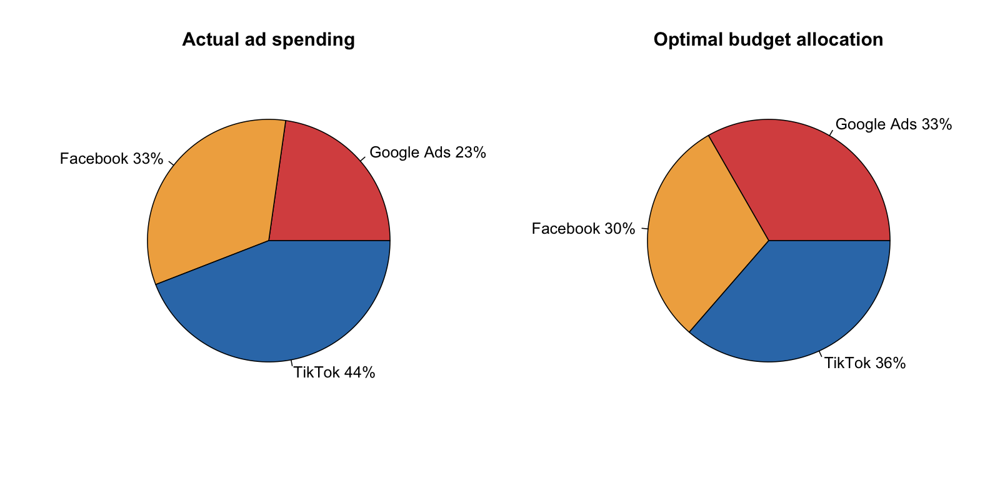
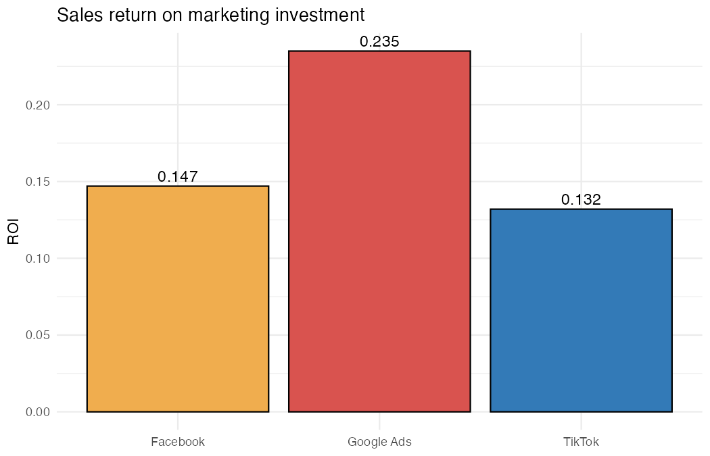
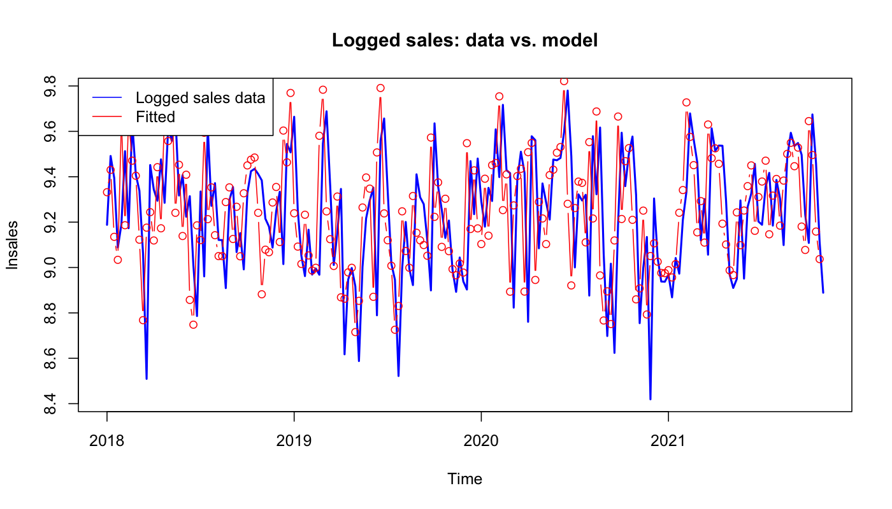

# Marketing Mix Modelling: Where Should the Ad Budget Go?

How much do **Google Ads, Facebook and TikTok** drive weekly sales, which channel gives the best return, and how should the budget be split?

This is a group project (**Group 22**) for **Strategic Marketing Decision Making** at Erasmus University Rotterdam. We built a marketing mix model in R for FourTex, a company advertising on three digital channels, using four years of weekly sales and ad spend (2018 onwards).

## Key findings

| | Google Ads | Facebook | TikTok |
|---|---|---|---|
| **Elasticity** (1% more spend → % more sales) | 0.033 | 0.030 | 0.036 |
| **Return on investment** | **0.235** | 0.147 | 0.132 |
| **Actual budget share** | 23% | 33% | 44% |
| **Optimal budget share** | **33%** | 30% | **36%** |

- **The model explains 85% of the variation in sales** (adjusted R² = 0.853). All three channels have a significant effect.
- **Sales have momentum.** The lagged sales coefficient is 0.356, so part of each week's sales carries over into the next.
- **Google Ads is the most efficient channel.** It returns the most sales per euro but gets the smallest share of the budget.
- **Recommendation:** move budget from TikTok, and slightly from Facebook, into Google Ads.
- **Channels partly cannibalise each other.** Heavy spending on Google Ads together with TikTok or Facebook reduces the effect of each (negative, significant interactions). They likely reach the same audience. TikTok and Facebook work independently.

<p align="center">
  
</p>

<p align="center">
  
</p>

## Method

1. **Explore** weekly sales and spend per channel (`figures/01_sales_and_spend.png`).
2. **Baseline models.** A linear model, then a linear model with lagged sales, for comparison.
3. **Final model.** A log-log regression with lagged sales:

   `ln(Sales_t) = β0 + λ·ln(Sales_t-1) + β1·ln(Google_t) + β2·ln(Facebook_t) + β3·ln(TikTok_t)`

   The log-log form captures diminishing returns and gives elasticities directly. The lag captures carry-over.
4. **Contribution and ROI.** Elasticities are converted into unit effects, multiplied by total spend per channel, and divided by cost.
5. **Budget allocation.** The optimal share per channel is proportional to its elasticity.
6. **Interactions.** We added pairwise channel interactions to test for synergy or cannibalisation.

<p align="center">
  
</p>

## Repository structure

```
├── R/marketing_mix_model.R     full analysis; writes all figures
├── figures/                    charts used in this README
├── report/fourtex_mmm_report.pdf   our written group report
└── data/README.md              about the dataset (not included)
```

## Reproduce

```bash
# put the course dataset at data/marketing_mix.csv, then:
Rscript R/marketing_mix_model.R
```

Requires R with `ggplot2`.

## Data

The dataset was provided by the course and is not shared here. See [`data/README.md`](data/README.md).

## Tools

R · linear regression · log-log marketing mix model · ROI analysis · ggplot2
